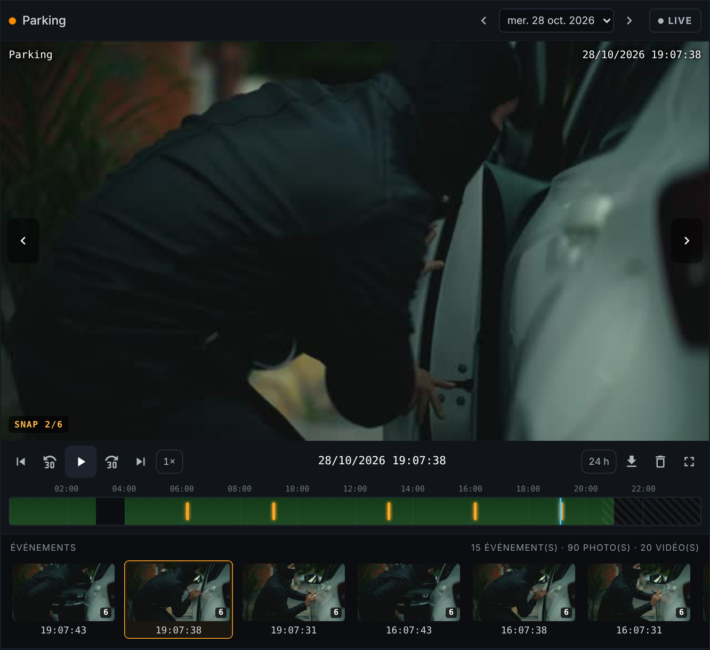

<p>
  ☕ <strong>Si cette carte vous est utile, vous pouvez soutenir le projet :</strong>
</p>

<div style="white-space: nowrap; line-height: 0;">
  <a
    href="https://www.buymeacoffee.com/Marlboro62"
    target="_blank"
    rel="noopener noreferrer"
    style="display: inline-block; text-decoration: none; vertical-align: middle;"
  ></a>&nbsp;&nbsp;<a
    href="https://ko-fi.com/M4M2QL45X"
    target="_blank"
    rel="noopener noreferrer"
    style="display: inline-block; text-decoration: none; vertical-align: middle;"
  ></a>
</div>

# NVR Card

Carte Lovelace pour Home Assistant qui transforme le tableau de bord en **enregistreur vidéo (NVR)** : direct de la caméra, frise 24 h des enregistrements, détections en photos, lecture, téléchargement et suppression — sans quitter Home Assistant ni ouvrir le NAS.

Un seul fichier JavaScript, sans dépendance.

**[▶ Essayer la démo en ligne](https://marlboro62.github.io/nvr-card/docs/demo.html)** : direct, frise, rafales de photos et lecture, avec une vraie vidéo libre de droits.



*Aperçu réalisé avec la démo. Vidéo : [« Balaclava assailant steals computer from car »](https://mixkit.co/free-stock-video/balaclava-assailant-steals-computer-from-car-31363/), [Mixkit](https://mixkit.co/), [licence Mixkit](https://mixkit.co/license/#videoFree) (scène jouée par des acteurs).*

## Fonctionnalités

- **Direct** de la caméra (lecteur intégré de Home Assistant, repli MJPEG automatique).
- **Lien direct go2rtc** (facultatif) : bouton ↗ qui ouvre la page `stream.html` de go2rtc, et option pour l'utiliser comme lecteur du direct dans la carte.
- **Mosaïque** en direct quand plusieurs caméras sont configurées, onglets pour passer de l'une à l'autre.
- **Frise 24 h** : plages enregistrées en vert, détections en orange, zoom 24 h / 6 h / 1 h.
- **Curseur glissable** sur la frise (souris ou doigt) : la vidéo suit en direct pendant le glisser.
- **Lecture des vidéos** à la minute cliquée, enchaînement automatique d'un fichier horaire au suivant, vitesse ×1 à ×8, ±30 s.
- **Détections** : les photos prises à quelques secondes d'intervalle sont regroupées en un événement ; bandeau de vignettes, navigation photo par photo et événement par événement, bouton ▶ pour lancer la vidéo quelques secondes avant la détection.
- **Téléchargement** et **suppression** des vidéos et des photos depuis la carte.
- **Éditeur visuel** : choix des caméras et des dossiers dans des menus, aucune ligne de YAML nécessaire.
- **Lien profond** pour les notifications : `?nvr=last` ouvre directement la dernière détection du jour.

## Arborescence attendue

Les fichiers doivent être accessibles dans le navigateur multimédia de Home Assistant (dossier local ou partage réseau monté en **Média**) :

```
<dossier>/
  25.10.2026/                 ← un dossier par jour (JJ.MM.AAAA)
    00h00.mkv … 23h00.mkv     ← un fichier vidéo par heure (mkv, mp4, mov, webm, avi)
    snap/                     ← sous-dossier des photos (nom configurable)
      13h00/                  ← un sous-dossier par heure
        13h54m12s.jpg …       ← photos nommées HHhMMmSSs.jpg
        13h54m12s_1.jpg …     ← ou rafale HHhMMmSSs_1.jpg, _2.jpg…
```

## Installation

### Avec HACS (dépôt personnalisé)

1. HACS → ⋮ → **Dépôts personnalisés**.
2. Dépôt : `https://github.com/Marlboro62/nvr-card`, type : **Tableau de bord** (Dashboard).
3. Installe **NVR Card**, puis recharge la page (Ctrl+F5).

### Manuelle

1. Copie `nvr-card.js` dans `/config/www/`.
2. Paramètres → Tableaux de bord → ⋮ → **Ressources** → Ajouter :
   - URL : `/local/nvr-card.js?v=1`
   - Type : **Module JavaScript**
3. Recharge la page (Ctrl+F5). Après chaque mise à jour du fichier, incrémente `?v=`.

## Monter un partage réseau (NAS, OMV…)

Paramètres → Système → Stockage → **Ajouter un stockage réseau** :

- Nom : `Surveillance`
- Utilisation : **Média**
- Protocole : Samba/Windows (CIFS) ou NFS
- Serveur : adresse IP du NAS
- Partage distant : nom du partage seul (par exemple `surveillance`, sans `\\` ni IP)

Le dossier apparaît dans *Médias → Médias locaux → Surveillance* et dans le menu de l'éditeur de la carte.

## Configuration

Ajoute la carte **NVR Card** depuis le sélecteur de cartes et règle tout dans l'éditeur visuel. Équivalent YAML :

```yaml
type: custom:nvr-card
cameras:
  - entity: camera.palier
    title: Palier
    media_root: media-source://media_source/local/Surveillance
    snap_folder: snap
live_layout: grid
aspect_ratio: 4/3
max_height: 60vh
event_gap: 60
preroll: 5
refresh: 60
osd: false
```

| Option | Défaut | Description |
|---|---|---|
| `cameras[].entity` | — | Entité caméra (obligatoire). |
| `cameras[].title` | nom de l'entité | Nom affiché. |
| `cameras[].media_root` | — | Dossier des enregistrements. Vide = direct seulement. |
| `cameras[].snap_folder` | `snap` | Sous-dossier des photos dans chaque jour. |
| `cameras[].go2rtc_url` | — | Lien direct go2rtc, par exemple `http://192.168.1.50:1984/stream.html?src=camera`. Ajoute un bouton ↗ qui l'ouvre dans un nouvel onglet. |
| `cameras[].go2rtc_live` | `false` | Utilise ce lien comme lecteur du direct dans la carte (WebRTC ou MSE de go2rtc, plus réactif). |
| `live_layout` | `grid` | `grid` (mosaïque) ou `single` (une caméra à la fois) quand il y a plusieurs caméras. |
| `aspect_ratio` | `16/9` | Format du lecteur. |
| `max_height` | `70vh` | Hauteur maximale du lecteur. |
| `event_gap` | `60` | Photos espacées de moins de X secondes = un seul événement. |
| `preroll` | `5` | Secondes de vidéo lues avant la détection. |
| `refresh` | `60` | Rafraîchissement du jour en cours (secondes). |
| `osd` | `true` | Incruste le nom et l'heure sur l'image (à désactiver si la caméra le fait déjà). |

L'ancienne syntaxe à une caméra (`entity:` / `media_root:` à la racine) reste acceptée.

## Lien depuis une notification

Ajoute un bouton à tes notifications de l'application mobile :

```yaml
actions:
  - action: URI
    title: "🎞 Voir l'événement"
    uri: /mon-tableau/ma-vue?nvr=last
```

- `?nvr=last` : ouvre la dernière détection du jour.
- `&nvr_cam=camera.xxx` : sélectionne une caméra précise (configuration multi-caméras).

## Bon à savoir

- **Direct go2rtc dans la carte** (`go2rtc_live`) : le lien doit être joignable par l'appareil qui affiche la carte. Depuis une adresse **https** (accès à distance), un lien **http** est bloqué par le navigateur (contenu mixte) : la carte garde alors le direct de Home Assistant, et le bouton ↗ ouvre go2rtc dans un nouvel onglet.

- **Format vidéo** : les navigateurs lisent le MP4/H.264 partout. Le MKV en H.264 passe en général sur Chrome et Edge, pas sur Firefox ni Safari/iOS. Le H.265 n'est quasiment lu nulle part. En cas d'échec, la carte propose le téléchargement pour une lecture dans VLC.
- **Positionnement dans la vidéo** : il nécessite des fichiers avec index de navigation. Certains enregistrements MKV écrits en continu n'en ont pas.
- **Suppression** : réservée aux comptes administrateurs Home Assistant et nécessite un partage accessible en écriture.

## Licence

MIT
